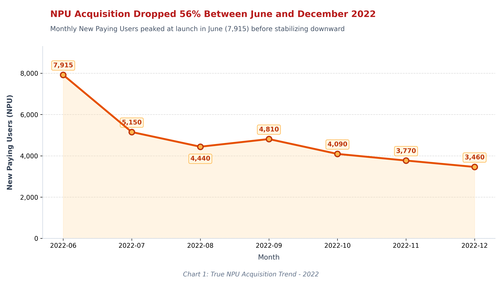
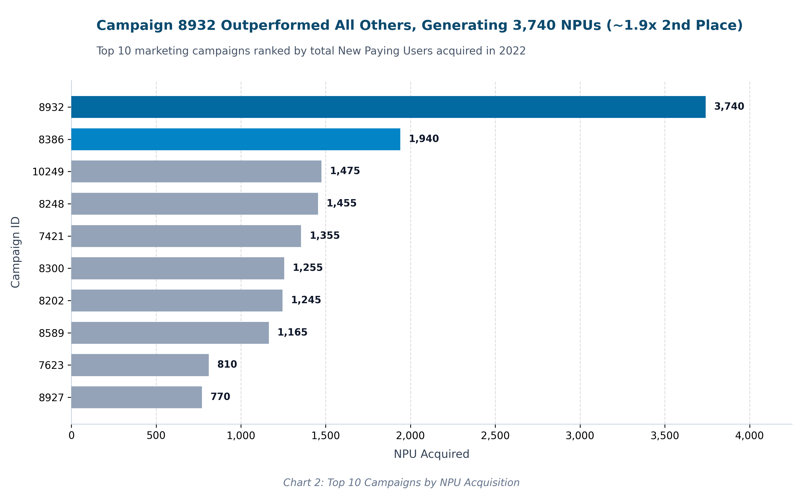
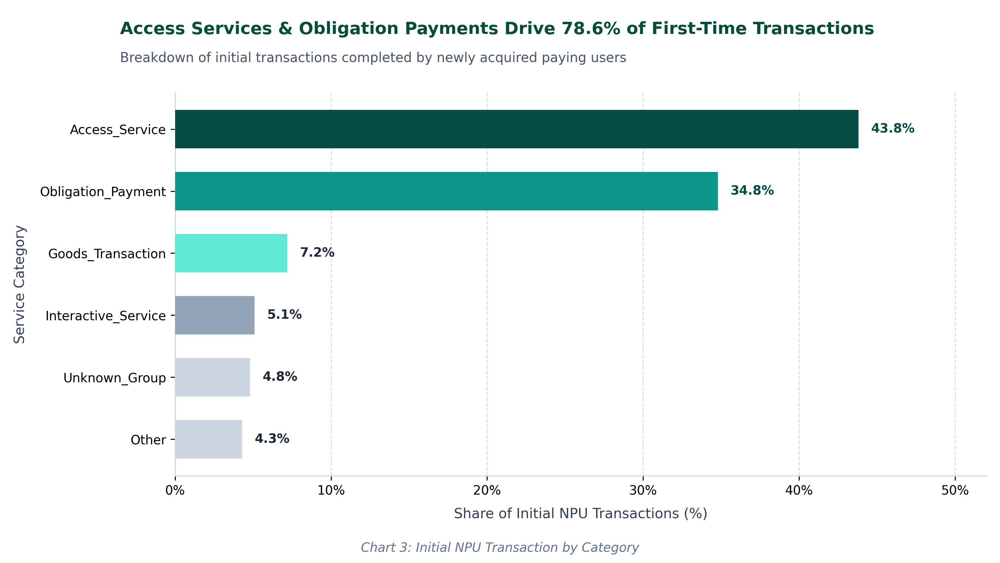
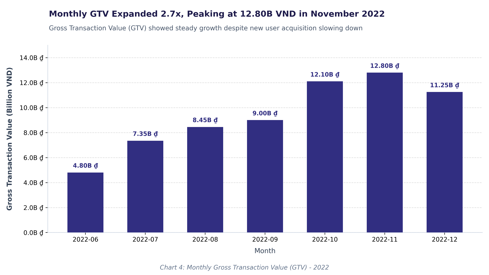

# ZaloPay New Paying User Campaign Effectiveness

## 1. Project Overview
This project evaluates the performance and effectiveness of ZaloPay's user acquisition campaigns during the 2022 fiscal year. By analyzing transactional data, user metadata, and merchant classifications, this analysis identifies the key drivers of New Paying User (NPU) acquisition, evaluates campaign efficiency, and maps initial user behaviors.

## 2. Business Objectives
- **Assess Platform Growth:** Understand the overall growth trajectory of ZaloPay in terms of Gross Transaction Value (GTV) and active customers.
- **Determine Campaign Effectiveness:** Identify which promotional campaigns are most effective at driving verified, high-intent New Paying Users.
- **Analyze User Intent:** Classify the initial services and products that successfully convert users from dormant/free to paying customers.

## 3. Dataset Overview
The analysis is based on three core relational tables:
- `transaction_info`: 301,107 records detailing transaction metadata, amounts, discounts, and statuses.
- `user_info`: 33,686 records containing account creation dates and demographic metadata.
- `merchant_info`: 748 records classifying application IDs into report categories and sub-categories.

## 4. Key Business Metrics & Definitions
- **Gross Transaction Value (GTV):** The total unadjusted value of all successful transactions on the platform.
- **New Paying User (NPU):** Defined strictly as a user whose *first-ever successful transaction on the platform* was attributed to a marketing campaign (`campaignID != 0`). 
  > *Note: Users whose first transaction was organic but subsequently used a promo code are excluded from NPU campaign attribution to preserve acquisition integrity.*
- **Incentive Subsidy Proxy:** The amount discounted from the total transaction value, serving as a proxy for the direct subsidy cost to acquire the user.

## 5. Analytical Approach

### NPU Acquisition Performance
The platform acquired **33,631 valid NPUs** through promotional campaigns in 2022. Acquisition peaked in June (7,913 NPUs) and experienced a downward trend throughout Q3 and Q4, stabilizing around 4,000 users per month by year-end.

### Campaign Effectiveness
Out of 453 launched campaigns, acquisition is heavily concentrated among top performers. 
- **Campaign 8932** was the undisputed top performer, acquiring 3,740 NPUs (over 11% of total NPU acquisition).
- **Campaign 8386** followed with 1,944 NPUs.

### Initial User Intent and Quality
When users make their first subsidized transaction, their intent is heavily skewed toward essential services:
- **Access Service** accounts for 43.8% of initial NPU transactions (driven heavily by Balance Increases).
- **Obligation Payment** accounts for 34.8% (driven by Utility Services).

## 6. Key Findings & Business Recommendations
1. **Optimize High-Performing Categories:** Over 78% of NPUs are acquired through Utility Payments and Balance Increases. Marketing budgets should be heavily allocated toward campaigns promoting these high-necessity categories to capture new users efficiently.
2. **Investigate Acquisition Decline:** While total platform GTV doubled from June to November (reaching 12.78B VND), NPU acquisition nearly halved in the same period. 
   
   *Recommendation:* ZaloPay is successfully monetizing its existing user base, but acquisition campaigns are losing efficiency. We recommend refreshing campaign creatives and testing new incentive thresholds to combat potential audience fatigue.
3. **Analyze Extreme Subsidy Outliers:** 4,397 transactions were completed with a user charge of 100 VND or less, resulting in a ~99% discount ratio. 
   *Recommendation:* Business rules should be reviewed to confirm if these deep subsidies align with Customer Acquisition Cost (CAC) targets, or if they represent platform abuse/loophole exploitation.

## 7. Proposed Campaign Evaluation Framework
To move beyond sheer acquisition volume, future iterations of this analysis should measure:
- **CAC (Customer Acquisition Cost):** Using exact marketing spend divided by validated NPUs.
- **Day-30 / Day-90 Retention:** Measuring the percentage of NPUs who make a *second, organic* transaction within 30 and 90 days.
- **Payback Period:** Calculating how long it takes for a cohort's generated margin to exceed their initial subsidy cost.

## 8. Limitations & Further Analysis
- **Negative Transaction Statuses:** 28,366 transactions feature negative status codes. Without a formal data dictionary, it is impossible to distinguish between system failures and user-initiated refunds.
- **Missing Promotion Context:** Missing values in `promotion_type` correlate exactly to `campaignID = 0`. This is expected behavior (organic transactions lack a promotion type), but should be standardized at the database level.
- **Retention Data Required:** Current datasets lack post-acquisition activity markers to calculate LTV (Life-Time Value) or retention curves.

## 9. Tools & Technologies
- **Python (Pandas, NumPy):** Data cleaning, anomaly detection, and metric aggregation.
- **Matplotlib & Seaborn:** Data visualization.
